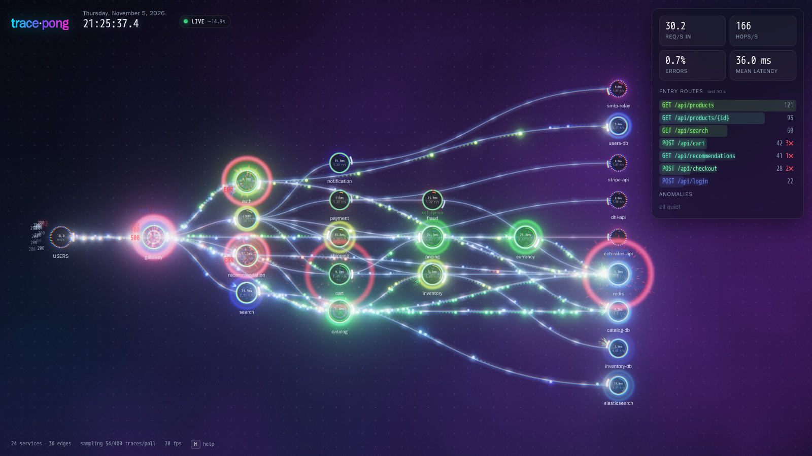

# trace-pong

A **Grafana panel plugin** that shows live service traffic from **Tempo**, drawn with **WebGPU**: the service graph
looks like Tempo's, the motion is as loud as Logstalgia's, and it shows both the topology and the
traffic, as promviz/Vizceral do. Unlike those, every ball is a **real call from a real trace**.



* **Nodes** are services, as in Grafana's service graph: a ring with a green/red health arc, mean
  latency and request rate inside. Databases are blue, third-party APIs are purple and dashed.
  Busy nodes heat up and glow.
* **Users** are nodes of their own, as in Logstalgia: every logged-in user (OAuth claims that Faro or the
  backend put on the trace's root span: `user.id` / `enduser.id`, `user.full_name`, `user.name`,
  `user.email`) is a small node in the **USERS** column on the left, in order of arrival, labelled with
  the user id (or the name when that is switched on) like Logstalgia's IP list. A user's label lights up while they are clicking around; people come and go.
* **Endpoint view** (help screen, <kbd>E</kbd>): one node per endpoint, grouped by service, e.g.
  `GET /api/health` and `GET /user/info` inside **ACCOUNT**. Databases split into server › database ›
  table (`postgres › users_db › user_info`) from `server.address`, `db.namespace`/`db.name` and
  `db.collection.name`/`db.sql.table` (or the table in the statement); frontends by Faro view.
* **Layout**: a force simulation (d3-force) arranges the graph, **radially** around the users by default
  (the frontend in the middle, each subtree of the call graph gets its slice of the circle), or **left to
  right** (<kbd>R</kbd>). Edges stay thin and faint so the traffic stands out.
  Groups are drawn as glowing outlines and keep apart from each other. Database servers attract each
  other, so the data layer forms one cluster; a server with several databases is a bubble of its
  databases (in the endpoint view: server › database › table, nested).
* **Calm**: the layout holds still for 20 s, re-arranges slowly over 4 s (the camera holds still meanwhile,
  then settles on the new picture), holds still again. Newcomers (a user
  logging in, a new endpoint) just appear in a free spot next to where they belong.
* **Balls** are hops (one client→server call) taken from fresh Tempo traces. The request flies to the
  callee and bounces off its ring in a spray of sparks. The ball stays inside (orbiting) for the span's
  duration and its own downstream calls, then **bounces back** as the response. Each trace replays as a
  causal rally: a downstream call only leaves once the ball that caused it has arrived.
  Every **user has their own colour**, and all balls of their traces carry it across the whole graph: the
  trace id (propagated via `traceparent`) ties every hop to the root span, where the user is. Anonymous
  traces get a colour from their trace id.
* **Shockwaves follow the status code**: green for 2xx, blue for 3xx, a bigger amber one for 4xx. Errors
  (5xx or error status) smash into the node in a large red explosion, and the code flies off at the caller.
* **Sound** (off by default, speaker button or <kbd>M</kbd>): synthesized space explosions, large for errors,
  medium for 4xx, distant pops for the rest. All voices share a long reverb and a compressor so they stack
  into a rumble, and a per-severity budget keeps busy graphs listenable.
* **Uninstrumented callers** (traces whose root is a server span without `traceparent` and without a
  user: crawlers, monitors, webhooks) come out of a soft **cloud** in the top left, about ten nodes across;
  each trace leaves from one of its many origin points and merges onto the edge.
* **Databases** are octagons.
* **No WebGPU, or a flaky one?** The panel asks for the high-performance GPU, then the default and the
  low-power one, and checks that every pipeline builds. If none works, or a device keeps failing or is
  lost, it carries on in a simple 2D canvas view (nodes, edges, balls, labels) with a "Retry WebGPU" button.
* **Follow a user**: click a user to see what their traces do, end to end: every node and edge their
  traces touched in the last 30 s (and what is queued) stays lit, from the frontend through the gateway
  and backends to the databases; everything else, including other users' balls and explosions, fades.
  Click again or press <kbd>Esc</kbd> to let go. Users are drawn as plain rings in their colour.
* Hover a node for its callers and callees with rate, latency and error rate; users show name, email and id.
  Endpoint and user rates are estimated from the sampled traces, scaled to the service graph's totals.
* Until there is data, a loading screen says what it is waiting for (data sources unreachable, no traces
  matching the filter, …).
* It is an ordinary panel: add it to any dashboard, pick the Tempo data source, filter with TraceQL.

## How it works

```
 Browser (panel)                         Grafana                       backends
 ─────────────────────────────────────   ───────────────────────────   ─────────────────────────
 every 1 s: TraceQL search, most recent ─┐
 then GET /api/v2/traces/<id> (≤ N/s)   ─┼─ /api/datasources/proxy ── Tempo
 every 3 s: PromQL traces_service_graph_*┘   (auth, tenant headers)  └ Mimir / Prometheus
```

There is no backend of its own. The panel calls Tempo and the metrics data source through **Grafana's
data source proxy**, so access rights, the tenant (`X-Scope-OrgID` custom header) and any other
data source settings come from Grafana.

* **Topology and stats** come from the series that Tempo's metrics-generator (service-graphs
  processor) remote-writes to Mimir: `traces_service_graph_request_total`, `…_failed_total` and
  `…_server_seconds_{sum,count}`. These are the same numbers Grafana's service graph uses,
  including virtual nodes for uninstrumented databases and APIs (`peer.service`, `db.name`, `db.system`)
  and the `user` node for roots.
* **Traffic** comes from Tempo traces. Each second the panel searches for the most recent traces matching
  the TraceQL filter, fetches the new ones by ID (up to *Traces per second*), and pairs spans the way the
  service-graph processor does: SERVER/CONSUMER span + parent CLIENT/PRODUCER span in another service, or a
  CLIENT span with no child and a peer attribute.
* Hops replay on a clock that always runs at real speed, a fixed delay behind real time (about 13 s with the
  Tempo setting below), set from the first traces that arrive. A trace that comes in later than that is
  started right away instead of slowing the clock. The clock top left shows playback time.

Each viewer polls on its own, so *Traces per second* × viewers is the load on Tempo.

### Rendering

Everything is drawn into an `rgba16float` HDR target with premultiplied blending: alpha 0 means
additive light. The passes are:

1. background: a drifting fbm nebula, a world-space dot grid, and heat glows behind busy nodes;
2. edges: tessellated Bézier curves with a soft glow, brighter with more traffic and redder with more errors;
3. balls with comet trails (instanced sprites), then nodes (SDF rings, health arc, load ring, halo);
4. sparks: a 32k-particle ring buffer in a storage buffer, integrated by a compute shader each frame and drawn as velocity-stretched streaks;
5. bloom: 6-level dual-filter (Kawase) down/up chain with soft threshold;
6. composite: ACES tonemap, slight chromatic aberration, vignette, film grain.

Text (labels, status codes, span names) is a 2D canvas on top, and the HUD is plain DOM.

### Code

TypeScript (strict) under [src/](src/), no runtime dependencies besides what Grafana provides:

| File | |
|---|---|
| `module.tsx` | the panel: options, data source resolution, React wrapper |
| `app.ts` | one instance in a panel element: input, camera, frame loop |
| `scene.ts` | nodes per view (services, endpoints, users), force layout, groups, playback clock, ball scheduling, effects, GPU instance data |
| `gpu.ts`, `shaders.ts` | WebGPU pipelines and WGSL |
| `tempo.ts` | live data: PromQL service graph, Tempo search and span pairing |
| `sim.ts` | the built-in simulator |
| `overlay.ts`, `hud.ts`, `ui.ts` | 2D labels, tooltip/clock, panel DOM and CSS |
| `audio.ts` | synthesized explosions |

The layout is a d3-force simulation with links, many-body repulsion, collision, a radial (or column) force per
call-graph depth, a target angle per subtree, and custom forces that hold groups together and keep sibling
groups apart.

[build.mjs](build.mjs) bundles `src/module.tsx` with esbuild into one AMD `module.js` (the format Grafana
loads plugins in; React, `@grafana/data`, `@grafana/runtime` and `rxjs` come from Grafana), writes
`plugin.json` with the version from `package.json`, and zips it. `tsc` only type-checks.

### Prior art this borrows from

* **Logstalgia** (C++/OpenGL/SDL): Pong on web-server logs. Each request is a ball flying from the
  client column towards a paddle by the URL list, with bloom, response codes popping up and
  misses for errors. trace-pong keeps the balls, the glow and the bursts, and maps them onto a service graph.
* **Vizceral / promviz** (three.js/WebGL): a left-to-right layered service graph with particles
  emitted along edges at a rate proportional to RPS, where red particles are errors. The particles are
  synthetic, sampled from rates. trace-pong uses the same layered layout but replays real calls.
* **Grafana's service graph / Node Graph** (Tempo): nodes as rings with a success/error arc and
  `ms/r · r/s` inside, plus a hover table of edges. trace-pong copies that information design.

## Install

The plugin is unsigned, so Grafana must be told to load it. Build the ZIP first (uses `npm` if installed,
otherwise a `node:22` container):

```bash
scripts/build.sh                     # type-check, build -> dist/tracepong-live-panel-1.9.0.zip
```

* **Any Grafana ≥ 11** (tested with 13.1): unzip into the plugin folder and allow the unsigned plugin:
  ```bash
  unzip dist/tracepong-live-panel-*.zip -d /var/lib/grafana/plugins
  GF_PLUGINS_ALLOW_LOADING_UNSIGNED_PLUGINS=tracepong-live-panel
  ```
* **Docker, mounting the ZIP**: Grafana only installs ZIPs from http(s) URLs, so this repo's compose
  mounts `dist/` and wraps the entrypoint with [grafana/install-plugins.sh](grafana/install-plugins.sh),
  which unpacks every mounted ZIP before starting Grafana. Copy the `grafana` service from
  [docker-compose.yml](docker-compose.yml).
* **From a URL** (e.g. a release asset):
  `GF_PLUGINS_PREINSTALL_SYNC=tracepong-live-panel@1.9.0@https://…/tracepong-live-panel-1.9.0.zip`.

Then add a visualization of type **trace-pong** to a dashboard. The panel title is the title.

### Panel options

| Option | Default | |
|---|---|---|
| Data | Live (Tempo) | or *Simulator*: a built-in fake shop, no data sources needed |
| Tempo data source | first Tempo data source | traces are replayed from here |
| Service graph metrics data source | the Tempo data source's *service map* data source | Mimir/Prometheus with `traces_service_graph_*` |
| TraceQL filter | `{ true }` | which traces to replay, e.g. `{ resource.deployment.environment = "prod" }` |
| Service graph label filter | – | PromQL matchers for the topology, e.g. `cluster="prod"` |
| Rate window | `1m` | for rates and latencies |
| Traces per second | 30 | upper bound fetched from Tempo, per viewer |
| Show playback clock, Labels, Bloom | on | |
| Ball speed, Latency stretch | 1, 2 | also on the keyboard |

Both filters accept dashboard variables. The TraceQL filter picks which balls fly; the label filter picks
the nodes and edges.

**Tempo setting.** By default, Tempo 3's query-frontend hides the newest 30 s from search
(`query_frontend.query_end_cutoff: 30s`). For near-live playback, set it to `2s`; with the default the
panel still works but runs about 35 s behind. Tempo's metrics-generator must have the `service-graphs`
processor enabled and remote-write to the metrics data source.

### Controls

Drag to pan, wheel to zoom, double-click to re-fit. The wheel zooms once you have clicked the panel, in
full screen, or with <kbd>ctrl</kbd> held (and trackpad pinch); otherwise it scrolls the dashboard. The buttons
top right zoom, re-fit and switch to **full screen** (also <kbd>Shift</kbd>+<kbd>F</kbd>; <kbd>Esc</kbd> leaves).
Click a service to pin focus. Keys work while the panel has focus: <kbd>space</kbd> pauses,
<kbd>+</kbd>/<kbd>-</kbd> change ball speed, <kbd>[</kbd>/<kbd>]</kbd> change latency stretch (how long balls
stay inside a service), <kbd>B</kbd>/<kbd>L</kbd>/<kbd>F</kbd> toggle bloom and labels or re-fit, <kbd>M</kbd> toggles sound, and
<kbd>H</kbd> shows help.

The help screen also has the **view** switches, remembered per browser: endpoints as nodes (<kbd>E</kbd>),
user names instead of ids (<kbd>U</kbd>), radial or left-to-right layout (<kbd>R</kbd>).

## Run the demo

```bash
# 1. the LGTM stack (the repo one level up, single node); its own Grafana is not needed
(cd .. && docker compose up -d alloy tempo mimir loki)

# 2. the plugin ZIP, the demo shop (15 services + Faro-like frontend) and a Grafana with the panel
scripts/build.sh
docker compose up -d --build

open http://localhost:3001            # the trace-pong dashboard is the home page
```

After changing `src/`, run `scripts/build.sh && docker compose restart grafana` and reload. With node installed:
`npm ci`, then `npm run typecheck`, `npm run dev` (unminified, source maps) or `npm run dist`.
`GRAFANA_PORT`, `TEMPO_URL`, `MIMIR_URL`, `LGTM_NETWORK` and `OTLP_ENDPOINT` adapt the compose to another stack.

## The demo shop (`mesh/`)

There is one small Python image, and `SERVICE=<name>` picks the role from `mesh/topology.py`. There are 15 instrumented
services (gateway, account, auth, catalog, search, recommendation, cart, pricing, currency, checkout,
inventory, payment, fraud, shipping, notification) that call each other over HTTP. The gateway has 12 routes
and `account` has 5 endpoints (`GET /user/info`, `GET /user/orders`, `PUT /user/settings`,
`DELETE /user/sessions`, `GET /api/health`). They use uninstrumented dependencies that Tempo turns into
virtual nodes: a `postgres` server with `users_db`, `catalog_db`, `inventory_db` and `orders_db` (several
tables each), `redis`, `elasticsearch`, `stripe-api`, `dhl-api`, `ecb-rates-api` and `smtp-relay`. A simulated
Kafka hop (producer → consumer spans) runs from checkout to notification. Spans are created by hand with the
OpenTelemetry SDK, so their shapes match exactly what the service-graph processor pairs, and they are exported over OTLP to Alloy.

The load generator plays **shop-web**, a browser app instrumented with Grafana Faro: each request is a root
CLIENT span with Faro's user and session attributes and view name, made by one of a rotating set of fake
OAuth users ([mesh/users.py](mesh/users.py): Google, Auth0, GitHub and Okta style ids, names, emails), and
carries the user's JWT to the gateway, which reads the claims and tags its server span with the user id. About 15% of
requests (`ANON_SHARE`) come from uninstrumented callers instead: no trace context, no token.

The load generator's traffic varies over time, with occasional flash crowds. Every 4 minutes one service
has a 70 s **incident** (errors or latency), computed from wall-clock time so all containers agree.
The incidents rotate through payment, search, inventory, currency, auth and catalog.
